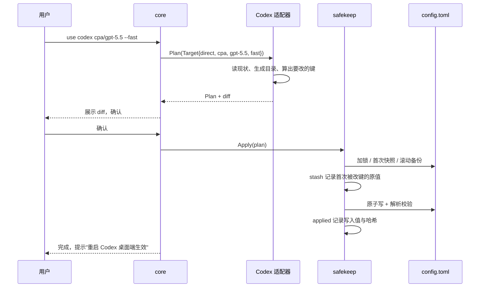

# QuickerConfigSwitch 架构设计

> 状态：设计基线（2026-10-17）。O/D、GUI/Web 和模式 R 的前台路由已实现；实际进度及验收边界见 [HANDOFF.md](HANDOFF.md)。
> 参考：[yetone/magpie](https://github.com/yetone/magpie)（MIT）、[openai/codex](https://github.com/openai/codex) 源码、[router-for-me/CLIProxyAPI](https://github.com/router-for-me/CLIProxyAPI)（下文简称 CPA）源码。

## 0. 一句话定位

一个跨 Windows / macOS / Linux 的本地小工具：**给 Codex、Claude CLI/Desktop 切换自定义 provider/模型，只改必要键，保留原登录数据、用户设置和原值，并在还原时保留用户后续改动。**
具体模式能否继续使用官方登录、会话的 provider 隔离和保留表等行为见 CLIENTS.md、
REQUIREMENTS.md；不能把配置原值还原等同于所有模式的整文件哈希完全相同。

---

## 1. 读 magpie 的结论：取什么、不取什么

magpie 是一个约 30 万行的 Go 项目（Wails v3 托盘应用 + 本地网关 `127.0.0.1:3425`）。它的能力分三层：

| 层 | magpie 里的内容 | 本项目 |
| --- | --- | --- |
| **配置写入层**（`internal/agent`、`internal/edit`） | 60+ 个 Agent 适配器；保格式编辑 TOML/JSON/YAML；`stash.json` 记录原值、`applied.json` 记录写入值做漂移检测；断开时还原 | **核心，取** |
| **provider 层**（`internal/provider`、`internal/catalog`） | 预设、多 key、订阅账号、models.dev 补全、导入 CC Switch | **取精简版**：自定义 provider + 模型列表 + `/v1/models` 拉取 |
| **网关层**（`internal/gateway`，6.7 万行） | OpenAI Chat / Responses / Anthropic / Gemini 互转、路由组、额度切换、插件、中间件、用量统计 | **只取一小块**：Codex 官方请求透传 + 按模型分流（见 §4.8，可选模块） |

明确不做（至少 v1 不做）：路由组/额度轮换、订阅当 provider、协议互转、插件系统、资料库（MCP/skills 同步）、用量统计、WebDAV 同步、60 个 Agent。

### 从 magpie 直接继承的设计原则

1. **只改自己该改的键**，其它内容（注释、顺序、空行、BOM、CRLF）原样保留。
2. **只删自己写的东西**。用户在我们写的 provider 表里加的键，重写时也要保留。
3. **先记原值再写**：每个键第一次被改之前，把原始值（或"原本不存在"）记下来；还原时按记录放回。
4. **写入原子化**：临时文件 + rename；保持文件权限、硬链接、软链接目标（dotfiles 仓库常见）；写前校验结果能被解析，坏了就拒绝写。
5. **漂移可见**：记录我们最后写了什么，别的工具（CC Switch、Codex 自己的 `/model`）改了之后能看出来，由用户决定"接受现状 / 重新应用 / 还原"。
6. **凭据文件不碰**：Codex 的 `auth.json`、Claude Code 的 `.credentials.json` / 钥匙串，一律只读（甚至不读）。

---

## 2. 核心问题：Codex 官方订阅 + Fast 模式（源码级分析）

### 2.1 Codex 怎么决定"发给谁、用什么登录"

来自 `codex-rs/model-provider-info/src/lib.rs`：

- 内置 provider `openai` 固定 `requires_openai_auth = true`。用 ChatGPT 登录时，默认地址是 `https://chatgpt.com/backend-api/codex`；用 API key 登录时是 `https://api.openai.com/v1`。
- 顶层键 **`openai_base_url`** 只替换内置 `openai` 的地址，**不改变登录方式**：请求照样带 ChatGPT 的 token。
- `[model_providers.openai]` **无法覆盖内置 openai**（合并时 `entry(key).or_insert`，内置优先）。
- 自定义 `[model_providers.X]` 默认 `requires_openai_auth = false`，用 `env_key` 或 `experimental_bearer_token` 发 key。切到它时 `auth.json` 不会被删，但这段时间里 Codex 不再用 ChatGPT 登录。
- **线程（会话）绑定 provider**：app-server 列会话时默认只列当前 `model_provider` 的（`thread_processor.rs`：`None => Some(vec![self.config.model_provider_id.clone()])`）。所以把 `model_provider` 从 `openai` 改成 `cpa`，桌面端的历史会话就"消失"了，改回来才出现。
- 写了 `model_provider = "X"` 却没有 `[model_providers.X]` 表，Codex 整个配置加载失败（"Model provider `X` not found"）；旧线程也要靠这张表才能恢复。

### 2.2 `/fast` 出现的两个条件

来自 `codex-rs/tui/src/chatwidget/service_tiers.rs`、`core/src/session/mod.rs`、`features/src/lib.rs`：

1. 功能开关 `features.fast_mode`（**默认开启**，Stable）。
2. **当前模型在模型目录里的条目带 `service_tiers`**，其中有名为 `Fast` 的档位（id `priority`）。没有这条，界面不显示 Fast，就算配置里写了 `service_tier = "fast"` 也会被丢掉，并提示 "not advertised as supported"。

模型目录从哪来（`codex-rs/models-manager`）：

| 情况 | 目录来源 |
| --- | --- |
| 内置 openai + ChatGPT 登录 | 从 `{base}/models` 拉取（后端按套餐给出 `service_tiers`），缓存在 `~/.codex/models_cache.json` |
| 自定义 provider（如 CPA） | 不拉取，用 Codex **内置的 models.json**（GPT 系列都带 `priority`） |
| 配置了 `model_catalog_json` | **只用这个文件**（不再回退内置目录） |

用户选的 Fast 存在 `config.toml` 顶层 `service_tier`（`"fast"` 与 `"priority"` 等价）。

### 2.3 CPA 会不会把 Fast 吃掉

核对 CPA `911f49cbd49f4fe2516979754a7488a3fd14fe64` 的
`internal/translator/codex/openai/responses/codex_openai-responses_request.go`：
`fast` 规范为 `priority`，`priority`、`ultrafast` 保留，其它值删掉。
qcs 保留目录中的 Fast 能力和请求档位；**实际优先级、计费与速度取决于 CPA、模型及上游账号**，
不能仅凭本地转发测试证明真实提速。实际 Codex 0.159.2 的隔离目录加载证据见 REQUIREMENTS.md。

### 2.4 为什么"整文件替换"式切换会丢东西

CC Switch 的 Codex 供应商同时保存 `auth`（即 `auth.json` 内容，第三方时是 `OPENAI_API_KEY`）和整份 `config`（`config.toml` 文本），切换时两个文件都整份写入。结果：

- `auth.json` 被换成 API key → **官方 ChatGPT 登录在第三方期间不存在**，切回要靠它备份的那份；
- `config.toml` 整份替换 → 期间用户/Codex 自己改的设置会被覆盖；
- `model_provider` 换了 → 桌面端历史会话按 provider 隐藏；
- 自定义模型名不在内置目录里 → 没有 `service_tiers` → **Fast 消失**。

### 2.5 本项目给 Codex 的三种模式

| | **O 官方** | **D 直连**（无常驻进程） | **R 保留订阅**（本地路由，可选模块） |
| --- | --- | --- | --- |
| 写入的键 | 无（还原态） | `model_provider`、`model`、`[model_providers.qcs-<id>]`，需要时加 `model_catalog_json` | **只有** `openai_base_url = "http://127.0.0.1:<port>/backend-api/codex"` |
| `auth.json` | 不碰 | 不碰（还在，但 D 期间不用） | 不碰，**照常使用** |
| ChatGPT 登录态（远程控制、云任务、Chrome 插件等） | 官方客户端决定 | 桌面端进入 API 状态 | 保持官方 provider 和认证方式；具体功能待真机验收 |
| 历史会话可见 | 官方 provider 的会话 | 只见 `qcs-<id>` 的会话 | 仍按官方 provider 列会话；旧直连会话仍有 provider 隔离 |
| 官方模型 | ✅ | 走 CPA（"全走 CPA"） | 子模式「并存」：官方模型走 ChatGPT，自定义模型走 CPA；子模式「全走 CPA」：全部走 CPA |
| Fast | ✅ | ✅：GPT 系列用内置目录；其它模型由我们生成 `model_catalog_json` 并带 `service_tiers` | ✅：官方模型用后端给的档位；自定义模型由路由生成的目录带档位 |
| 依赖 | 无 | 无 | 本地路由进程必须在跑（关闭时自动去掉 `openai_base_url`） |
| 切回官方 | — | 删 `model_provider`/`model_catalog_json`，还原 `model`；**保留 provider 定义，撤销 qcs 写入的密钥**（旧线程要用） | 删 `openai_base_url`（若用户原来有，还原原值） |

用户的两个诉求对应关系：

- "**继续保留官方订阅登录**" → D 和 R 都不碰 `auth.json`，切回即恢复；R 期间登录仍在使用。
- "**全部模型请求走 CPA，但保留原始的 Fast**" → D 或 R「全走 CPA」保留档位；若还要活动官方登录，使用 R。CPA 需支持发来的模型与档位。
- 保留官方 provider 下的会话与登录态，应使用 R；具体桌面功能仍需真机验收。目录和其它官方路径不属于「全部模型请求」。

> O、D、R 均已实现。实现状态和验收边界以 HANDOFF.md、REQUIREMENTS.md 为准。

---

## 3. 总体架构

```
┌──────────────────────────── qcs（单个二进制） ────────────────────────────┐
│                                                                          │
│   GUI（Wails v3：托盘 + 主窗口）      CLI（qcs use / restore / diff …）      │
│              │                               │                           │
│              └──────────── core API ─────────┘                           │
│                              │                                           │
│   ┌──────────┬──────────┬────┴─────┬───────────┬──────────────┐          │
│   │ provider │ profile  │  agent   │ safekeep  │  codexcat    │          │
│   │ 供应商/  │ 方案     │ 适配器   │ 快照/原值/ │ Codex 模型   │          │
│   │ 模型     │          │ 注册表   │ 漂移       │ 目录生成     │          │
│   └──────────┴──────────┴────┬─────┴─────┬─────┴──────────────┘          │
│                              │           │                               │
│                         ┌────┴───────────┴────┐                          │
│                         │ edit：保格式编辑器   │  TOML / JSON(C) / env     │
│                         │ + 原子写入           │  BOM / CRLF / 链接        │
│                         └─────────────────────┘                          │
│                                                                          │
│   relay（可选，模式 R）：127.0.0.1:<port>/backend-api/codex                  │
└──────────────────────────────────────────────────────────────────────────┘
        │ 写配置                                  │ 模式 R 下的请求
        ▼                                         ▼
 ~/.codex/config.toml                    chatgpt.com/backend-api/codex（官方，原样透传）
 ~/.claude/settings.json                 CPA / 其它 Responses 兼容上游（自定义模型）
```

---

## 4. 模块设计

### 4.1 `edit`：保格式编辑器

从 magpie `internal/edit` 移植（MIT，保留版权声明），只保留需要的部分：

| 文件 | 能力 |
| --- | --- |
| `toml.go` | `GetTOMLTop / SetTOMLTop / DelTOMLTop`（顶层键）；`GetTOMLTable / SetTOMLTable / SetTOMLKey / DelTOMLKey / DelTOMLTable`（整表为单位）；内联表 `Inline`；写后用 go-toml 重新解析校验 |
| `json.go` | JSON/JSONC 按 key path 设置/删除，保留注释与尾逗号；解析失败直接拒绝，不在半解析的文档上改 |
| `env.go` | `.env` 风格文件（后续 Agent 用） |
| `file.go` | `Read`（去 BOM）、`WriteAtomic`（保 BOM、保权限、保硬链接、跟随软链接、清理残留临时文件）、`Atomically`（多文件一起写，失败回滚） |

### 4.2 `safekeep`：保住原配置（本项目的核心卖点）

三份记录，各管一件事：

| 记录 | 位置 | 作用 |
| --- | --- | --- |
| **原始快照** | `backups/<agent>/<file>/original-<时间>` | 第一次接管某文件时整份复制一次，永不覆盖 |
| **滚动备份** | `backups/<agent>/<file>/<时间>.bak`（保留最近 20 份） | 每次写入前复制当前文件 |
| **键级原值** `stash.json` | `state/stash.json`（0600） | `<agent>.<file>.<key>` → `{existed, raw}`；只在该键**第一次**被我们改时记录 |
| **写入记录** `applied.json` | `state/applied.json` | 每个键我们最后写的值 + 文件写后的哈希，用于漂移检测与"逐字节还原"判断 |

**还原算法**（`Restore`）：

1. 若当前文件哈希 == `applied.json` 记录的写后哈希（说明我们写完后没人动过），且有原始快照 → **逐字节还原**（注释、格式完全一致）。
2. 否则 → **键级还原**：按 `stash.json` 放回原值，原本不存在的键删掉；别人后来加的内容不动。
3. 例外规则由适配器声明，例如 Codex 的 `[model_providers.qcs-*]` 表在键级还原时**保留**（旧线程恢复需要它）。
4. 还原前一律先生成 diff 预览（dry-run），确认后才写。

**漂移检测**（`Check`）：对比 `applied.json` 与文件现状，结果分为：`ok`、`changed`（某键被改）、`removed`（被删）、`external`（被 CC Switch 等工具整份替换）。界面给三个按钮：接受现状 / 重新应用 / 还原官方。

### 4.3 `provider`：自定义供应商与模型

```jsonc
// providers.json（0600）
{
  "providers": [{
    "id": "cpa",
    "name": "CPA 本地",
    "baseURL": "http://127.0.0.1:8317/v1",
    "apiKey": "sk-xxx",
    "apis": {                        // 该上游能说哪些协议，决定能给哪些 Agent 用
      "responses": true,             // Codex 只吃 Responses
      "chat": true,
      "anthropic": "http://127.0.0.1:8317"  // Claude Code 用，可与 baseURL 不同
    },
    "headers": {},
    "models": [{
      "id": "gpt-5.5",
      "name": "GPT-5.5",
      "efforts": ["low", "medium", "high", "xhigh"],
      "fast": true,                  // 是否给 Codex 打上 priority 档
      "context": 272000,
      "images": true
    }]
  }]
}
```

- 预置几个模板（CPA、OpenAI 兼容中转、Anthropic 兼容中转），只是表单默认值，不是 magpie 那种完整预设库。
- "拉取模型"按钮：调用 `GET {baseURL}/models`，用户勾选要用的。
- `fast` 默认值：`gpt-*` / `o\d` 开头且上游支持 Responses 时默认勾选（与 magpie `OwnFast` 一致），其它默认不勾。
- key 先存本地文件（0600），后续可选系统钥匙串。

### 4.4 `agent`：适配器接口

```go
type Agent interface {
    ID() string                          // "codex", "claude"
    Name() string
    Detect() Detection                   // 是否安装、配置路径、版本、是否 ChatGPT/claude.ai 登录（只看"有没有"，不读 token）
    Files() []string                     // 管理哪些文件
    Modes() []Mode                       // 支持的模式：official / direct / relay
    Current() (State, error)             // 当前在官方还是哪个 provider/模型/模式
    Plan(t Target) (*Plan, error)        // 只计算要改的键，不落盘
    Restore() (*Plan, error)             // 计算还原计划
    Check() []Drift                      // 漂移与健康检查（doctor）
    Notice(t Target) string              // 例如"Codex 桌面端需重启生效"
}

type Target struct {
    Mode     Mode    // official | direct | relay
    Provider string  // provider id
    Model    string
    Fast     *bool   // nil = 不动用户现有的 service_tier
    Effort   string
    RelayAll bool    // 模式 R：true=全走上游，false=官方与自定义并存
}
```

`Plan` 是一组 `FileEdit{Path, Ops[]}`（Set/Del 顶层键、Set/Del 表、写生成文件），统一由 `safekeep.Apply(plan)` 执行：加锁 → 首次快照 → 滚动备份 → 记原值 → 原子写 → 校验 → 记写入值。适配器不直接写文件。

### 4.5 Codex 适配器要守住的规则

| 规则 | 原因 |
| --- | --- |
| 永不写 `auth.json` | 官方登录就在这里 |
| `model_provider = X` 和 `[model_providers.X]` 必须同时存在 | 否则 Codex 无法加载配置 |
| 切走后保留 `[model_providers.qcs-*]` | 在它上面开的线程恢复时要用 |
| 不动用户的 `service_tier`、`[features]`、`[desktop]`、`[profiles.*]`、`[mcp_servers.*]` | 用户自己的 Fast 选择与其它设置 |
| 写 `model_catalog_json` 时必须带上所有想在选择器里看到的模型 | 显式目录会让 Codex 不再回退内置目录 |
| 不碰 CC Switch 的 `custom` / `cc-switch-*` 表 | 共存，由用户自己决定 |
| key 用 `experimental_bearer_token` 而不是 `env_key` | 从 Dock/开始菜单启动的桌面端拿不到 shell 环境变量 |
| `wire_api = "responses"` | 当前 Codex 只支持 Responses |
| 写后提示重启 | Codex app-server 只在启动时读 base URL |

模式 D 写入示例（只有这些行是我们加的）：

```toml
model_provider = "qcs-cpa"
model = "gpt-5.5"
model_catalog_json = "/Users/me/Library/Application Support/QuickerConfigSwitch/codex/catalog-cpa.json"  # 仅当需要时

[model_providers.qcs-cpa]
name = "CPA 本地"
base_url = "http://127.0.0.1:8317/v1"
wire_api = "responses"
experimental_bearer_token = "sk-xxx"
```

模式 R 写入示例：

```toml
openai_base_url = "http://127.0.0.1:17321/backend-api/codex"
```

### 4.6 `codexcat`：生成 Codex 模型目录（保 Fast 的关键）

参考 magpie `internal/codexcat`：

1. 读取 Codex 自己的目录条目：优先 `~/.codex/models_cache.json`（就是官方后端给这个账号的，含套餐对应的 `service_tiers`），没有则用我们内置的一份 Codex `models.json`。
2. 对每个要展示的模型：
   - slug 与官方条目相同（如 CPA 上的 `gpt-5.5`）→ **整条复制官方条目**（指令、推理档位、`service_tiers` 都一样，行为与官方一致）；
   - 去掉日期后缀能对上官方条目 → 复制它的 `service_tiers`；
   - 其它模型 → 生成通用条目（Codex 通用提示词、`shell_type=unified_exec`、`apply_patch=freeform`、`supports_search_tool` 等必填字段），`fast: true` 时加 `{"id":"priority","name":"Fast","description":"..."}`。
3. 写文件时保留用户手工加在条目上的字段（magpie `codexcat.Keep` 的做法）。
4. 只有当"所选模型都在 Codex 内置目录里"时才可以不写目录文件；默认写，以便选择器里列出该 provider 的全部模型。

### 4.7 Claude Code 适配器

写入 `~/.claude/settings.json`：

```jsonc
{
  "model": "claude-opus-5-5",
  "env": {
    "ANTHROPIC_BASE_URL": "http://127.0.0.1:8317",
    "ANTHROPIC_AUTH_TOKEN": "sk-xxx",
    "ANTHROPIC_DEFAULT_OPUS_MODEL": "claude-opus-5-5",
    "ANTHROPIC_DEFAULT_SONNET_MODEL": "claude-opus-5-5",
    "ANTHROPIC_DEFAULT_HAIKU_MODEL": "claude-opus-5-5",
    "ANTHROPIC_SMALL_FAST_MODEL": "claude-opus-5-5",
    "ANTHROPIC_CUSTOM_HEADERS": ""
  }
}
```

- 只改当前单一 provider 所需的 env/model，以及显式请求的 effort；清理冲突云/子代理/
  workflow 别名与过期模型标签。原值进 stash，还原时保留用户期间的新改动。
- claude.ai 登录（`.credentials.json` / 钥匙串）不碰；切回原配置并重启后使用原登录。
  空认证可能让 CLI 把官方 OAuth 发到第三方，因此直连需明确第三方 token/Authorization。
- 模型 ID 保持上游原样。原生 CLI 可能错误识别 dotted ID 的能力；直连不能照搬 Magpie
  依赖网关反向映射的 dashed 改写，显式 effort 不可靠时直接拒绝。
- managed 配置覆盖目标键时拒绝切换，完整处理六种云开关；显式 effort 同时校验原生
  能力、provider 声明和现有 maxEffortLevel，不放宽原上限。细节见 CLIENTS.md。
- Claude CLI 的 Fast 由客户端管理，本工具不接管它的流量或接受直连 Fast 覆盖。

### 4.7.1 Claude Desktop

独立 `claude-desktop` 适配器将 Magpie 的 3p wiring 改为 plan/safekeep：必要的 gateway
profile/meta 先写，两个 deploymentMode 最后写；多文件失败一起回滚，原登录文件不写。
MSIX 不同版本的两套目录分别记录原值，界面用服务端 ModelRefs 限制可配置的模型。
只提取单一 Anthropic endpoint/Claude 模型配置，不引入多模型别名转换、账户池或出站策略。
3p 不继续使用官方 Anthropic 登录；完整支持范围及数据隔离见 CLIENTS.md。

### 4.8 `relay`：本地路由（模式 R，可选模块）

一个只绑定 `127.0.0.1` 的小型反向代理，**不做协议互转**（上游必须支持 Responses，CPA 支持）。

| 请求 | 处理 |
| --- | --- |
| `GET /backend-api/codex/models` | 用请求里的原始头（Authorization、ChatGPT-Account-Id）向 `chatgpt.com` 取官方列表 → 追加自定义模型条目（由 codexcat 生成，带 `service_tiers`）→ 返回 |
| `POST /backend-api/codex/responses`、`/responses/compact` | 读 `model`：「并存」且为官方 slug → **原样**转发 chatgpt.com（body 里的 `service_tier` 不动 → 订阅 Fast 正常）；自定义模型（`cpa/gpt-5.5`）或「全走上游」→ 改写 `model`、换成 provider 的 key、去掉 ChatGPT 专用头 → 转发到 `{baseURL}/responses`（或 `/responses/compact`）；SSE 流原样回传 |
| WebSocket 升级 | 回 426，让 Codex 退回 HTTP（magpie 同样做法） |
| 其它路径（如 `/wham/usage`） | 原样转发 chatgpt.com |

安全与可靠性：

- 只在内存里转发 Codex 自己的请求到它自己的后端；**不读取、不保存、不复用** ChatGPT token。
- 进程正常退出时删除 `openai_base_url`（magpie `EndCodexFailover` 的做法）；异常退出后，下次启动先修复。
- 托盘常驻 + 可选开机自启；端口被占用时自动换端口并重写配置。

CLI 使用 `qcs use codex <provider>/<model> --relay` 前台持有路由；GUI/Web 和托盘由同一进程的 `core.RelayController` 管理。`core.PrepareRelay` 先获取进程锁、预留 loopback 端口并生成预览；用户确认后 `Start` 再检查配置和 provider 是否变化，交由 `safekeep.Apply` 写入。GUI/Web 返回预留会话的一次性确认 ID，取消或两分钟过期释放；Wails 同步退出钩子和 Web 服务停止均关闭控制器。退出通过会话标记的条件还原，避免撤销其它进程后来做出的切换。异常退出释放系统文件锁，下一次启动可接管原有快照，也可显式执行 `qcs relay recover`。

路由不自动改变当前模型或 Fast 设置；并存模式将 `<provider>/<model>` 别名追加到官方目录，并在转发时去掉前缀。第三方请求采用独立的头部集合，不携带官方请求中的登录、账户或 cookie。HTTP/SSE 直接转发，不跟随上游重定向。运行中的路由不能通过普通方案保存或启动。

Codex 在官方 provider + ChatGPT 登录时默认启用 zstd 请求压缩（`codex-rs/core/src/client.rs` 的 `responses_request_compression`）。路由对压缩前后正文都设大小限制，解压读取模型；官方请求继续使用原始压缩字节，第三方请求使用去前缀后的 JSON 并移除编码头。第三方查询参数不透传，3xx 返回 502，避免客户端绕过路由向新地址转发账户头。

目录请求精简移植 Magpie `codexModels`：给官方后端三秒预算，成功时保留目录字段，
401/403 原样返回；其它不可用情况只读有界的 `models_cache.json` 回退，过滤旧 provider
前缀条目再追加当前别名。无缓存则返回当前别名。并存模式的未知命名空间在本地拒绝，
全走上游仍允许上游自身带 `/` 的模型 ID。来源与本地适配见 UPSTREAM.md。

### 4.9 GUI 与 CLI

- **GUI**：Wails v3（托盘 + 主窗口，与 magpie 相同），前端为原生 JavaScript 模块，通过 `go:embed` 进二进制，无单独构建步骤。三个页面：
  - **Agents**：每个 Agent 一行，显示"官方 / provider/model / 模式 / 漂移状态"，下拉切换，切换前弹 diff。
  - **Providers**：增删改、拉取模型、勾选 Fast、测试连通性。
  - **方案（Profiles）**：把所有 Agent 当前的选择存成一个名字，一键切换；"官方"是内置方案。
- **CLI**（同一个二进制，`-tags nogui` 可构建纯命令行版）：

```sh
qcs ls                                  # 各 Agent 当前状态
qcs provider add cpa --base http://127.0.0.1:8317/v1 --key sk-xxx
qcs provider models cpa --fetch         # 拉取并勾选模型
qcs use codex cpa/gpt-5.5 --fast        # 模式 D
qcs use codex cpa/gpt-5.5 --relay       # 模式 R（并存）
qcs use codex official                  # 切回官方
qcs diff codex official                 # 只看变更
qcs restore codex [--exact]             # 还原（能逐字节就逐字节）
qcs doctor                              # 漂移、冲突、常见坑
qcs save work && qcs load work          # 方案
```

---

## 5. 目录结构

```
QuickerConfigSwitch/
├── cmd/qcs/main.go            # 入口：无参数 = GUI，子命令 = CLI
├── internal/
│   ├── appdir/                # 各平台数据目录；QCS_HOME 可覆盖（测试用）
│   ├── edit/                  # 保格式编辑器 + 原子写（移植自 magpie）
│   ├── store/                 # providers.json / profiles.json / settings.json，损坏时回退 .bak
│   ├── provider/              # Provider/Model、/models 拉取、能力探测
│   ├── safekeep/              # 快照、滚动备份、stash、applied、Apply/Restore/Check
│   ├── agent/                 # 接口、注册表、Plan 类型
│   │   ├── codex/             # 模式 O/D/R、规则见 §4.5
│   │   └── claude/            # §4.7
│   ├── codexcat/              # Codex 模型目录生成（含 service_tiers）
│   ├── relay/                 # 模式 R 本地路由
│   ├── profile/               # 方案
│   ├── gui/                   # Wails 宿主 + JSON API + 托盘
│   └── cli/                   # 子命令
├── web/                       # 前端源码（构建产物 embed 到 gui）
├── testdata/                  # 各种真实形态的配置样本（BOM、CRLF、注释、内联表…）
└── docs/
```

## 6. 数据文件位置

| 系统 | 目录 |
| --- | --- |
| macOS | `~/Library/Application Support/QuickerConfigSwitch/` |
| Windows | `%APPDATA%\QuickerConfigSwitch\` |
| Linux | `$XDG_CONFIG_HOME/quickerconfigswitch/`（默认 `~/.config/...`） |

```
providers.json   settings.json   profiles.json
state/stash.json  state/applied.json  state/lock
backups/<agent>/<file>/original-*  *.bak
codex/catalog-<provider>.json
logs/
```

Agent 配置路径遵循各自的环境变量：Codex 用 `CODEX_HOME`（默认 `~/.codex`），Claude Code 用 `CLAUDE_CONFIG_DIR`（默认 `~/.claude`）。

## 7. 一次切换的流程



## 8. 测试策略

- **沙箱 HOME**（magpie `testenv` 的做法）：测试里把 HOME / USERPROFILE / APPDATA / XDG_* / CODEX_HOME / CLAUDE_CONFIG_DIR 全指到临时目录，绝不碰真机。
- **往返测试**：对 `testdata/` 里每份样本，`Apply → Restore` 后必须与原文件**逐字节相同**；中间插入"用户改了别的键"后，键级还原只撤销我们的键。
- **形态覆盖**：BOM、CRLF、混合换行、注释、内联表、点号键、多行字符串、软链接、硬链接、只读文件、损坏文件（必须拒绝写）。
- **Codex 契约测试**：生成的 `config.toml` 与目录 JSON 用 go-toml / Codex 的字段要求校验；CI 可选装真实 `codex` 二进制做加载验证。
- **relay**：用假的 chatgpt 后端与假的 CPA 验证分流、头部改写、SSE 透传、`service_tier` 不丢。

## 9. 路线图

| 阶段 | 内容 |
| --- | --- |
| **P0 核心（CLI）** | 工程骨架；移植 `edit`；`store`、`safekeep`；Codex O/D + codexcat；Claude Code O/D；`qcs ls/use/diff/restore/doctor/provider`；往返测试 |
| **P1 GUI** | Wails v3 托盘 + 主窗口；方案；拉取模型；漂移界面；从 CC Switch / 现有配置导入 provider |
| **P2 模式 R** | relay；关闭时清理；开机自启；端口自愈 |
| **P3 扩展** | Gemini CLI、OpenCode 等适配器；WSL；系统钥匙串存 key；会话迁移（把 `qcs-*` 线程改回 `openai`）；可选的 Chat→Responses 转换 |

## 10. 风险与待定事项

| 风险 | 应对 |
| --- | --- |
| Codex 配置格式变化快 | 适配器按版本判断；写后解析校验；契约测试跟版本 |
| 模式 R 进程挂掉导致 Codex 不可用 | 退出时清理、启动时修复、托盘状态提示 |
| 模式 D 下桌面端历史会话按 provider 隐藏 | 界面明确提示；P3 提供会话迁移 |
| key 明文在 `config.toml`（模式 D） | 与 CC Switch 相同的现实限制；文件权限保持原样，P3 可选 `auth` 命令取 key |
| Wails v3 仍是 beta | magpie 已在三平台用它发版；必要时 GUI 可降级为 `qcs web`（浏览器打开本地页面） |

**需要确认的决定**（见对话）：技术栈、首批 Agent、模式 R 是否进 MVP、前端框架。
